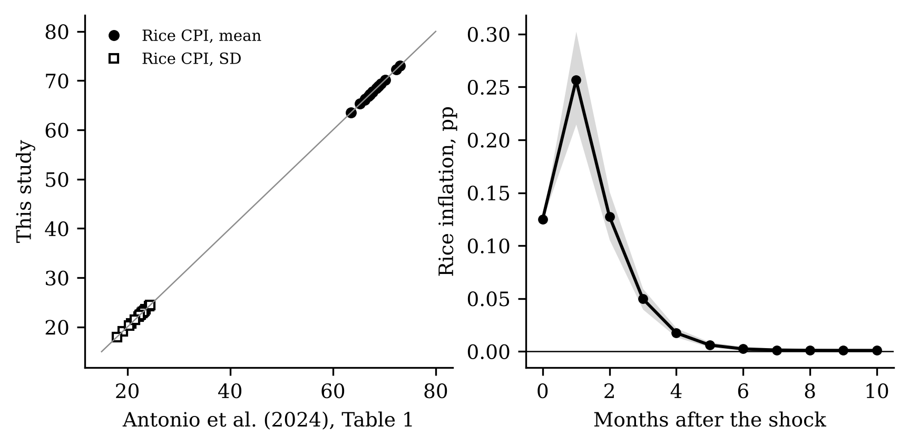
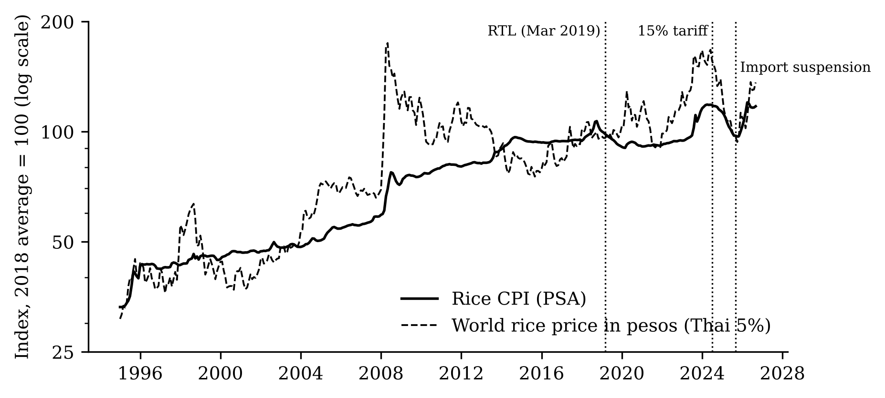
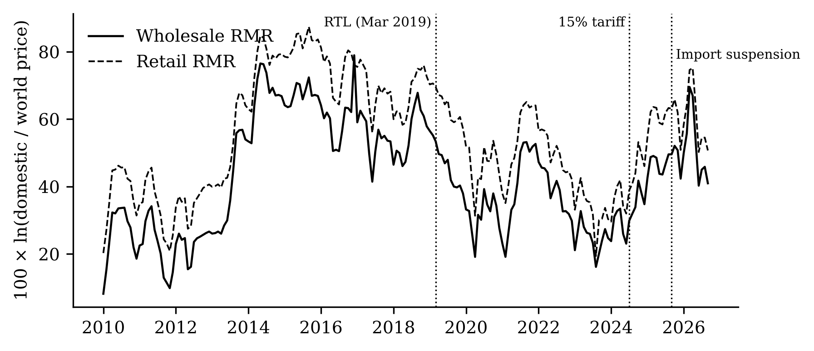
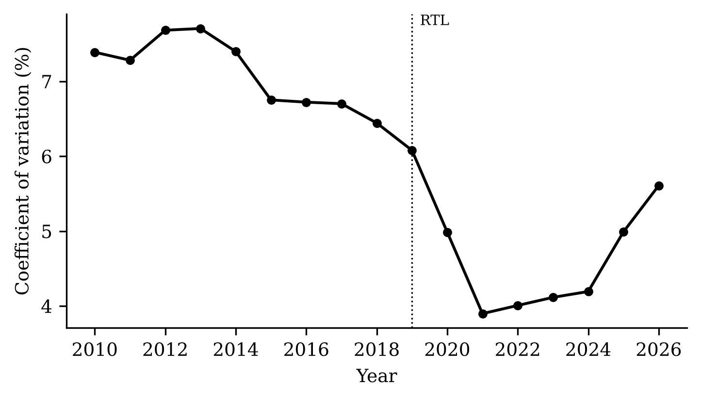
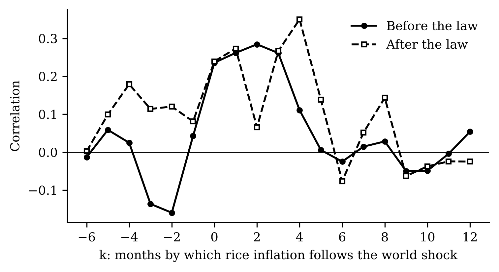
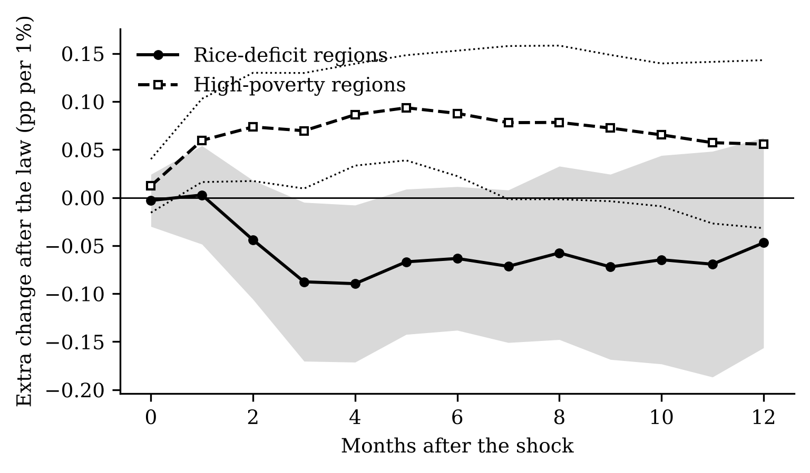
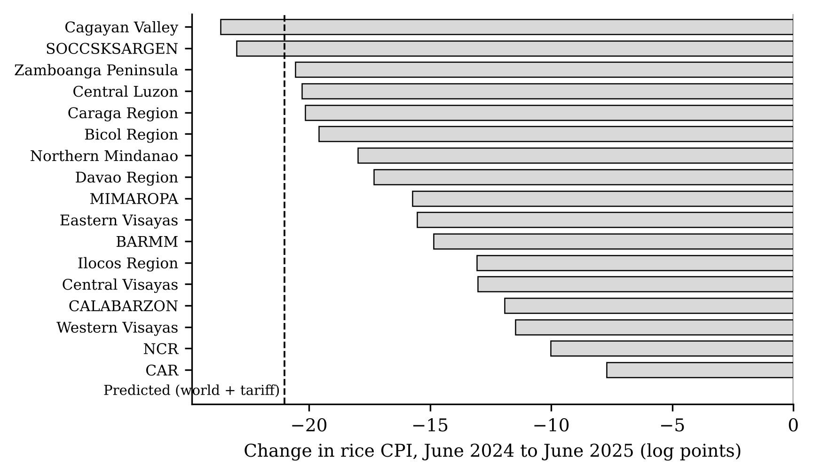
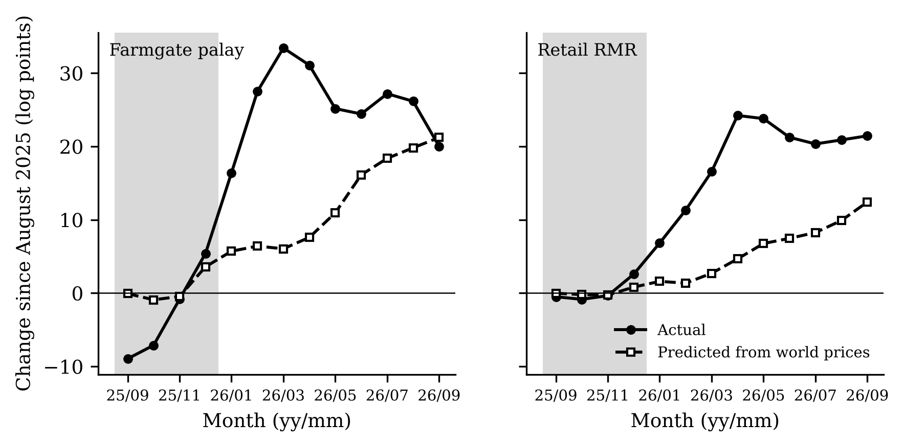

<#-- Rendered by scripts/10_analysis_report.py. Numbers come from output/tables. --#>

> **How to read this report.** *Log points:* we measure changes as 100 × the change in
> the natural log of a price, which is close to a percentage change. *Shock:* a 1% rise
> in the world rice price (Thai 5% broken rice, in pesos). *Response or pass-through:*
> how many percentage points a domestic price has risen, in total, a given number of
> months after that 1% shock; 0.5 means half of the world price change has reached the
> domestic price. *Before/after the law:* before or from March 2019, when the Rice
> Tariffication Law (RTL) replaced import quotas with a tariff. *Gap:* all-income
> inflation minus bottom-30% inflation; negative means the poor face more inflation.
> *Bands:* grey areas and dotted lines are 90% intervals; if a band excludes zero, the
> estimate is significant at 10%. Full tables of every estimate are in the Statistical
> Annex.

```{=openxml}
<w:p><w:r><w:br w:type="page"/></w:r></w:p>
```

# Part A. Checking the tools

## A1. Can we reproduce the reference study?

**Context and process.** Before trusting any new number, we checked that our data and
code reproduce Antonio et al. (2024), who studied regional rice inflation from 1994 to
2023. We wrote down pass criteria before downloading any data, rebuilt their data from
PSA's website and re-estimated their panel vector autoregression.

{width=90%}

**What the figure shows.** All 34 points on the left lie on the line of equality: our
regional means and standard deviations equal theirs (largest difference
{{ n.g1_max_dev }}). On the right, rice inflation jumps after a world price shock, peaks
after one month at {{ n.g2_h1 }} points and is gone by month six, as in their paper.

**What it means.** The data and the core method are right. One pre-registered check
failed: rice-deficit regions respond {{ n.g3_peak_ratio }} times as strongly as surplus
regions at the peak, short of the 1.3 we required. Results by region group are therefore
labelled "not validated" throughout.

```{=openxml}
<w:p><w:r><w:br w:type="page"/></w:r></w:p>
```

# Part B. The data at a glance (Objective 1)

## B1. Domestic and world rice prices since 1995

**Context and process.** We put the PSA rice consumer price index (CPI) and the world
rice price in pesos on the same scale (2018 = 100) to see whether they move together,
and how that changed with the law.

{width=95%}

**What the figure shows.** Under quotas (to 2019) the domestic price was smooth and
often far from the world price, for example in 2014–2016. After 2019 the two lines
move together much more, through the 2023 spike and the 2025 fall, until early 2026,
when domestic prices jumped while world prices were flat.

**What it means.** The law tied domestic prices to world prices. Monthly rice inflation
became more volatile: its standard deviation rose from {{ n.desc_sd_rice_quota }} under
quotas to {{ n.desc_sd_rice_tariff35 }} under the 35% tariff and {{ n.desc_sd_rice_late }}
after July 2024.

```{=openxml}
<w:p><w:r><w:br w:type="page"/></w:r></w:p>
```

## B2. The gap between domestic and world prices

**Context and process.** We compute how far the domestic price per kilogram is above
the world price per kilogram, in log points, every month since 2010.

{width=95%}

**What the figure shows.** The gap averaged {{ n.rq3_mean_gap_pre }} log points under
quotas, {{ n.rq3_mean_gap_tariff35 }} under the 35% tariff and {{ n.rq3_mean_gap_after2024 }}
after the 2024 tariff cut.

**What it means.** The law narrowed the gap, but cutting the tariff in 2024 did not
narrow it further; it widened. A lower duty that does not show up in the gap was kept
somewhere along the chain.

```{=openxml}
<w:p><w:r><w:br w:type="page"/></w:r></w:p>
```

## B3. Are regional rice markets more integrated?

**Context and process.** We measure how different retail rice prices are across the 17
regions each year (coefficient of variation: standard deviation divided by the mean).

{width=80%}

**What the figure shows.** Dispersion fell from {{ n.cv_2015_17 }}% in 2015–2017 to
{{ n.cv_2021_24 }}% in 2021–2024, then rose to {{ n.cv_2026 }}% in 2026.

**What it means.** With imports open to any trader, rice moves more freely across
regions and prices converge. The 2026 rise coincides with the price surge after the
import suspension.

```{=openxml}
<w:p><w:r><w:br w:type="page"/></w:r></w:p>
```

## B4. When do world shocks show up in domestic inflation?

**Context and process.** We correlate this month's world price change with rice
inflation k months later, separately before and after the law.

{width=80%}

**What the figure shows.** Before the law the correlation peaks at {{ n.cc_pre_max }}
after {{ n.cc_pre_kmax }} months; after the law at {{ n.cc_post_max }} after
{{ n.cc_post_kmax }} months. Both lines are noisy.

**What it means.** In both regimes world price changes reach domestic inflation within
about half a year. Simple correlations cannot say more; the estimates in Part C control
for other influences.

```{=openxml}
<w:p><w:r><w:br w:type="page"/></w:r></w:p>
```

# Part C. The estimates (Objective 2)

## C1. Did pass-through to consumer rice prices rise? (RQ1)

**Context and process.** For each horizon from 0 to 12 months we regress the total rice
inflation in each region on the world price shock, allowing the response to differ
before and after March 2019, with twelve lags, corrections for later shocks, a trend and
region effects (local projections).

{width=80%}

**What the figure shows.** Six months after a 1% world price rise, regional rice prices
are {{ n.rq1_pre_6 }} points higher before the law and {{ n.rq1_post_6 }} after it. The bands
overlap at twelve months.

**What it means.** Pass-through to consumers rose after the law, but the evidence is
suggestive: the change ({{ n.rq1_th_6 }}) is significant only at 10% at six months and not
at twelve.

```{=openxml}
<w:p><w:r><w:br w:type="page"/></w:r></w:p>
```

## C2. How robust is that change?

**Context and process.** We re-estimated the change in pass-through under fifteen
alternative choices fixed in advance: other world prices, controls, lag lengths,
excluded years, sample windows and error types.

{width=95%}

**What the figure shows.** At six months the change ranges from {{ n.rob_min6 }} to
{{ n.rob_max6 }} and stays significant in {{ n.rob_n_sig6 }} of {{ n.rob_n_checks6 }} checks.
It is smallest with data ending June 2024 ({{ n.rob_h_end_2024m6_6 }}). At twelve months it
is significant in {{ n.rob_n_sig12 }} checks.

**What it means.** The direction is stable; the size and significance are not. At six
months, much of the measured rise depends on the months after mid-2024.

```{=openxml}
<w:p><w:r><w:br w:type="page"/></w:r></w:p>
```

## C3. Who along the chain feels world prices? (RQ2)

**Context and process.** The same method on national farmgate palay, wholesale and
retail rice prices, 2011 to 2026.

{width=100%}

**What the figure shows.** Before the law the responses are flat at zero at every stage.
After it, six-month pass-through is {{ n.rq2_farmgate_palay_post_6 }} at the farmgate,
{{ n.rq2_wholesale_rmr_post_6 }} at wholesale and {{ n.rq2_retail_rmr_post_6 }} at retail.

**What it means.** This is the clearest result of the study. Under quotas, farmers and
consumers were insulated from world prices; under tariffs they are not, and farmers most
of all. Low world prices now mean low palay prices.

```{=openxml}
<w:p><w:r><w:br w:type="page"/></w:r></w:p>
```

## C4. Do world rice shocks hurt the poor more? (RQ5)

**Context and process.** National all-items CPIs for all households and for the bottom
30%, and their gap, 2001–2026.

{width=95%}

**What the figure shows.** Six months after a 1% world rice price rise the bottom-30%
CPI is {{ n.rq5_b30_6 }} points higher, against {{ n.rq5_all_6 }} for all households; the gap
falls by {{ n.rq5_gap_6 }}.

**What it means.** World rice shocks are regressive: they raise the cost of living of
the poor {{ n.rq5_ratio6 }} times as much. Rice's larger weight in the poor's basket
({{ n.w_rice_b30 }}% against {{ n.w_rice_all }}%) explains about {{ n.rq5_mech_share }}% of
this.

```{=openxml}
<w:p><w:r><w:br w:type="page"/></w:r></w:p>
```

## C5. Do regions differ? (RQ4, not validated)

**Context and process.** We allowed the post-law change to differ in rice-deficit and
high-poverty regions (groups from Antonio et al.).

{width=80%}

**What the figure shows.** At twelve months the extra change is {{ n.rq4_insuff_12 }}
(deficit) and {{ n.rq4_highpov_12 }} (high poverty); neither is significant.

**What it means.** We find no robust regional difference in how the law changed
pass-through. Because the reference paper's group pattern did not replicate, this part
carries little weight.

```{=openxml}
<w:p><w:r><w:br w:type="page"/></w:r></w:p>
```

# Part D. The current episode and policy (Objective 3)

## D1. Did the 2024 tariff cut reach consumers?

**Context and process.** Using only data up to June 2024, we predicted how much the rice
CPI should fall after July 2024 from world prices and from the cut of the tariff from 35%
to 15% ({{ n.ep_tau }} log points in the import cost), and compared with what happened.

{width=80%}

**What the figure shows.** By June 2025 the rice CPI fell {{ n.ep_e1_actual_m12 }} log
points. World prices alone predicted {{ n.ep_e1_pred_world_m12 }}; world prices and the
tariff cut, {{ n.ep_e1_pred_total_m12 }}.

**What it means.** Consumers got the fall in world prices but not the tariff cut. For a
poverty-line family of five, which spends about PHP {{ n.ep_e3_rice_spend }} a month on
rice, the predicted tariff saving of about PHP {{ n.ep_e3_saving_tariff_m12 }} a month did
not materialise.

```{=openxml}
<w:p><w:r><w:br w:type="page"/></w:r></w:p>
```

## D2. The tariff cut by region

**Context and process.** The same comparison for each region's rice CPI.

{width=80%}

**What the figure shows.** Falls range from {{ n.ep_e2_smallest_fall }} in
{{ n.ep_e2_smallest_fall_region }} to {{ n.ep_e2_largest_fall }} in
{{ n.ep_e2_largest_fall_region }}; only {{ n.ep_n_regions_below_pred }} regions fell by more
than predicted.

**What it means.** The shortfall was general, not confined to a few regions.

```{=openxml}
<w:p><w:r><w:br w:type="page"/></w:r></w:p>
```

## D3. The 2025 import suspension (exploratory)

**Context and process.** We compared farmgate and retail prices after August 2025 with
the path predicted from world prices alone.

{width=95%}

**What the figure shows.** Farmgate prices first fell ({{ n.ep_e4_farm_aug25_sep25 }}% in
September 2025), then rose {{ n.ep_e4_farmgate_palay_apr26 }}% by April 2026; retail prices
rose {{ n.ep_e4_retail_rmr_apr26 }}%. World prices predicted {{ n.ep_e4_farmgate_palay_pred_apr26 }}%
and {{ n.ep_e4_retail_rmr_pred_apr26 }}%.

**What it means.** Closing the border was followed by a price surge far beyond what world
prices explain, felt by consumers months after the suspension ended. The model was not
built for a closed border, so we treat this as descriptive.
