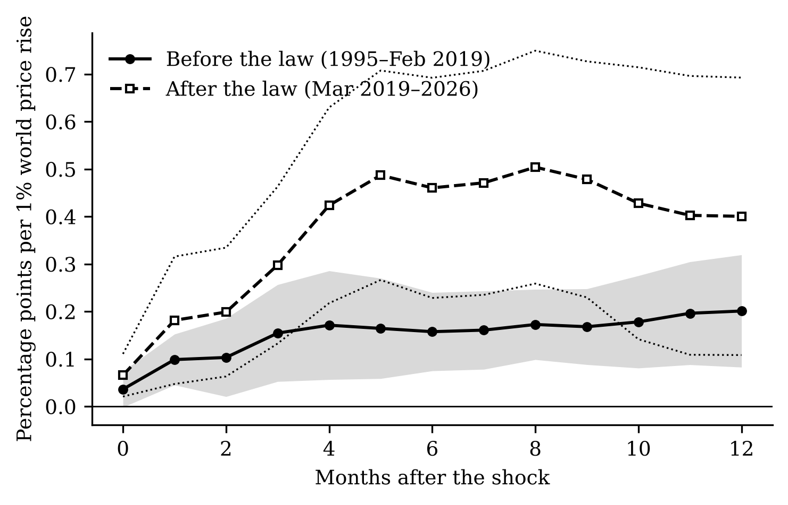
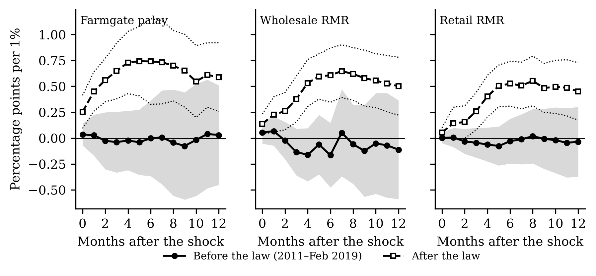
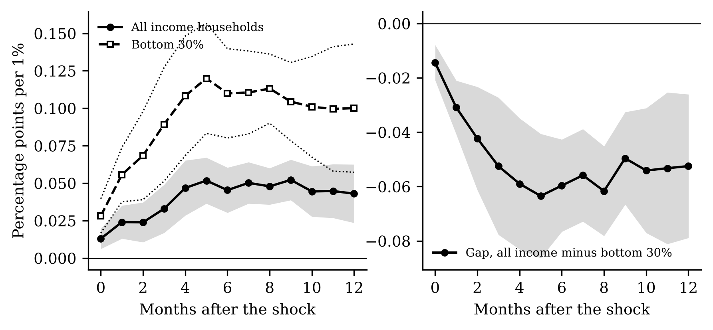
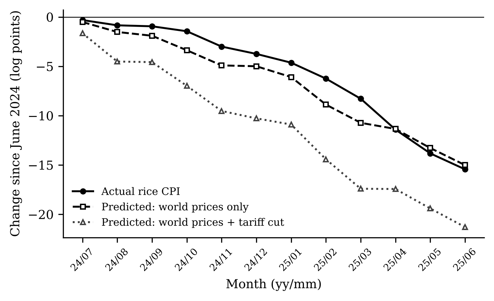
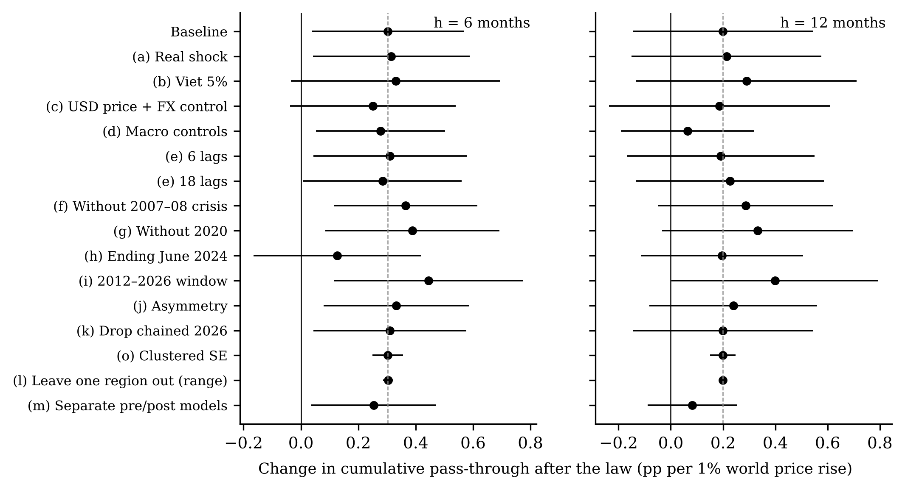

<#-- Rendered by scripts/08_paper.py from output/tables; do not edit the rendered files. --#>

**Abstract.** The Philippines replaced quantitative restrictions on rice imports with a
35% tariff in March 2019. Using monthly official data for 17 regions from 1995 to
September 2026 and local projections, we estimate how much of a world rice price change
reaches domestic prices before and after the reform. We first reproduce the data and the
main impulse response of Antonio et al. (2025) exactly; one pre-registered criterion on
region groups fails. Six-month pass-through to regional rice consumer prices rises from
{{ n.rq1_pre_6 }} to {{ n.rq1_post_6 }} percentage points per 1%, a change significant
only at the 10% level and sensitive to the sample end and to macroeconomic controls.
Along the supply chain, pass-through rises from about zero to {{ n.rq2_farmgate_palay_post_6 }}
(farmgate), {{ n.rq2_wholesale_rmr_post_6 }} (wholesale) and {{ n.rq2_retail_rmr_post_6 }}
(retail). World rice shocks raise the bottom-30% consumer price index {{ n.rq5_ratio6 }}
times as much as the all-income index. An out-of-sample test shows that the 2024 tariff
cut from 35% to 15% did not reach consumers within a year, and the domestic–world price
gap widened.

**Keywords:** rice; tariffication; price transmission; local projections; Philippines.
**JEL:** F13, Q17, Q18, E31.

# 1. Introduction

Rice takes {{ n.w_rice_all }}% of the average Filipino household's consumer basket and
{{ n.w_rice_b30 }}% of the poorest 30% households' basket. For decades, quantitative
restrictions (QR) and a state importer insulated domestic prices from the world market.
Republic Act 11203, the Rice Tariffication Law (RTL), replaced them with a 35% tariff
from March 2019. Later measures moved the border back and forth: a 15% tariff from July
2024, an import suspension from September to December 2025, and a price-indexed tariff
from January 2026.

Each measure assumes something about pass-through, the share of a change in the cost
of imported rice that reaches domestic prices. The trade-reform literature predicts
that replacing quotas with tariffs raises pass-through [@baffes2003; @mundlak1992].
Studies of the Philippine chain since 2019 find weak links to world prices and market
power downstream [@bathan2025; @trinidad2026]. Antonio et al. [-@antonio2025] show that
world rice prices are the main driver of regional rice inflation, but do not test for a
change with the law.

We make three contributions. First, we replicate Antonio et al. on the same public
data, with pass criteria fixed in advance, and report one failure. Second, we estimate
the change in pass-through with the law for consumer, retail, wholesale and farmgate
prices, and for the consumer price index (CPI) of the poorest 30%. Third, we test the
2024 tariff cut out of sample.

# 2. Methods

**Data.** Philippine Statistics Authority (PSA) regional rice CPI (2018 = 100, item
01.1.1.12), all-income and bottom-30% CPIs and weights, and national retail, wholesale
and farmgate rice prices; World Bank Pink Sheet rice prices (Thai 5%); Bangko Sentral ng
Pilipinas (BSP) exchange rates. The shock is $f_t = 100\,\Delta\ln(P^W_tE_t)$, the world
price in pesos. The 17-region panel uses the PSA's old geographic code, extended to 2026
with new-code growth; the rice CPI and the separate retail price survey correlate at
{{ n.val_cpi_retail }} in monthly changes.

**Specification.** For $h = 0,\dots,12$ we regress cumulative rice inflation
$\sum_{j\le h}\pi_{r,t+j}$ on $f_t$, $f_t\times\text{post}_t$ (post = 1 from March 2019),
twelve lags of $\pi$ and $f$, Teulings–Zubanov leads $f_{t+1},\dots,f_{t+h-1}$
[@teulings2014], a trend and region fixed effects [@jorda2005]. $B_h$ is cumulative
pass-through and $\theta_h$ its change. Panel standard errors are Driscoll–Kraay
[@driscoll1998]; national ones Newey–West. Decisive horizons, $h = 6$ and $h = 12$, and
a fifteen-item robustness menu were fixed before estimation.

**Validation.** Before downloading data we registered a replication gate (Table 1). Our
rice CPI statistics match Antonio et al.'s Table 1 exactly in all 17 regions; a panel VAR
replica reproduces their response to a world price shock ({{ n.g2_h1 }} at one month,
fading by month six). The ratio of peak responses in rice-deficit to surplus regions is
{{ n.g3_peak_ratio }}, below the registered range [1.3, 3.0], and the poverty ordering is
not reproduced. We proceed, with region-group results labelled as not validated.

{{ t.gate }}

: Table 1. Pre-registered replication gate against Antonio et al. (2024 working paper version).

**Border gap and episode.** The gap $G_t = 100\ln(P^{\text{dom}}_t/(E_tP^W_t/1000))$ is
regressed on dummies for the law, the 15% tariff and the suspension, with month dummies.
For the 2024 cut we apply post-law pass-through estimated on data ending June 2024 to
world shocks and to the tariff shock $100\ln(1.15/1.35)$ = {{ n.ep_tau }}.

# 3. Results

**Pass-through to consumers.** Table 2 reports cumulative pass-through to regional rice
CPIs. The change at six months, {{ n.rq1_th_6 }} ({{ n.rq1_th_6_se }}), is significant at
10% (p = {{ n.rq1_th_6_p }}); at twelve months, {{ n.rq1_th_12 }} ({{ n.rq1_th_12_se }}), it
is not.

{{ t.rq1 }}

: Table 2. Cumulative pass-through to regional rice CPIs (pp per 1%), 1995M1–2026M9; Driscoll–Kraay standard errors; \* p<0.10, \*\* p<0.05, \*\*\* p<0.01.

**Robustness.** Across checks the six-month change ranges from {{ n.rob_min6 }} to
{{ n.rob_max6 }}. It is larger in a symmetric 2012–2026 window ({{ n.rob_i_symmetric_2012_6 }})
and without the 2007–08 crisis ({{ n.rob_f_no_2008crisis_6 }}), but only
{{ n.rob_h_end_2024m6_6 }} ({{ n.rob_h_end_2024m6_6_se }}) with data ending June 2024, and the
twelve-month change is {{ n.rob_d_macro_controls_12 }} with macroeconomic controls. A
placebo law date in 2016 gives {{ n.rob_placebo_6 }} ({{ n.rob_placebo_6_se }}). Full results
are in Table 3.

{{ t.robust }}

: Table 3. Change in pass-through after the law, θ, across robustness checks.

**Along the chain.** From 2011 to February 2019 pass-through was statistically zero at
the farmgate, wholesale and retail levels; after the law it is large and significant at
six months (Table 4), and largest at the farmgate.

{{ t.rq2 }}

: Table 4. Pass-through to national farmgate, wholesale and retail rice prices, 2011M1–2026M9; Newey–West standard errors.

**Regions (not validated).** The extra post-law change is {{ n.rq4_insuff_12 }}
({{ n.rq4_insuff_12_se }}) in rice-deficit and {{ n.rq4_highpov_12 }} ({{ n.rq4_highpov_12_se }})
in high-poverty regions at twelve months, neither significant.

**The poor.** A 1% world price rise raises the all-items CPI by {{ n.rq5_all_6 }} pp for all
households and {{ n.rq5_b30_6 }} pp for the bottom 30% within six months; the gap falls by
{{ n.rq5_gap_6 }} ({{ n.rq5_gap_6_se }}). Rice weights explain about {{ n.rq5_mech_share }}%
of the gap. The pattern did not change with the law.

**Border gap.** The wholesale gap fell {{ n.rq3_wholesale_its_post }} log points after the
law (p = {{ n.rq3_wholesale_its_post_p }}) and rose {{ n.rq3_wholesale_its_tariff15 }} after
the 2024 tariff cut (p = {{ n.rq3_wholesale_its_tariff15_p }}); controlling for the world
price, the rise is {{ n.rq3_wholesale_its_world_tariff15 }} (Table 5).

{{ t.rq3 }}

: Table 5. Border gap regressions, 2010M1–2026M9; Newey–West standard errors.

**The 2024 tariff cut.** The model predicted a fall of {{ n.ep_e1_pred_total_m12 }} log points
in the rice CPI from June 2024 to June 2025 ({{ n.ep_e1_pred_world_m12 }} from world prices,
{{ n.ep_e1_pred_tariff_m12 }} from the tariff). The actual fall, {{ n.ep_e1_actual_m12 }},
matches the world-price part alone. For a poverty-line family of five the forgone saving
is about PHP {{ n.ep_e3_saving_tariff_m12 }} a month on predicted pass-through, out of a
full tariff wedge of PHP {{ n.ep_e3_full_tariff_wedge }}.

**The 2025 suspension (exploratory).** Between November 2025 and April 2026 the rice CPI
rose {{ n.ep_e4_rice_nov25_apr26 }}% while the world price in pesos rose
{{ n.ep_e4_world_nov25_apr26 }}%.

# 4. Discussion

The law opened the border most visibly for farmers: farmgate prices now follow world
prices closely, which is the intended transmission of a tariff regime and the source of
farmers' complaints about low palay prices. For consumers the evidence of higher
pass-through is suggestive rather than conclusive, and later tariff cuts appear to have
been absorbed along the chain, consistent with Trinidad, Ravago and Balisacan
[-@trinidad2026]. World rice shocks remain regressive.

**Policy.** Tariff changes should be judged by measured pass-through, not by the size of
the tariff change; the chain's margins after the 2024 cut deserve scrutiny by competition
authorities; and support during world price spikes is best targeted at poor households.

**Limitations.** The law is a single national event, so "after the law" mixes the law with
the pandemic, the 2023 world price spike and the 2024 tariff cut. The replication failed
on region groups. The 2025–26 episode is descriptive. The policy calculations use 2018
basket weights and the 2023 poverty threshold.

**Conclusion.** Tariffication tied Philippine rice prices more closely to the world
market, especially at the farmgate, but tariff cuts after 2019 did not lower consumer
prices as intended.

# Declarations

**Funding:** [to be completed]. **Competing interests:** none declared. **Data and code
availability:** all data are public (PSA OpenSTAT, World Bank, BSP, NOAA); raw files,
code and a one-command rebuild are in the replication package. **Author contributions:**
[to be completed].

# References

::: {#refs}
:::

# Figures

{width=80%}

{width=100%}

{width=95%}

{width=80%}

{width=95%}
