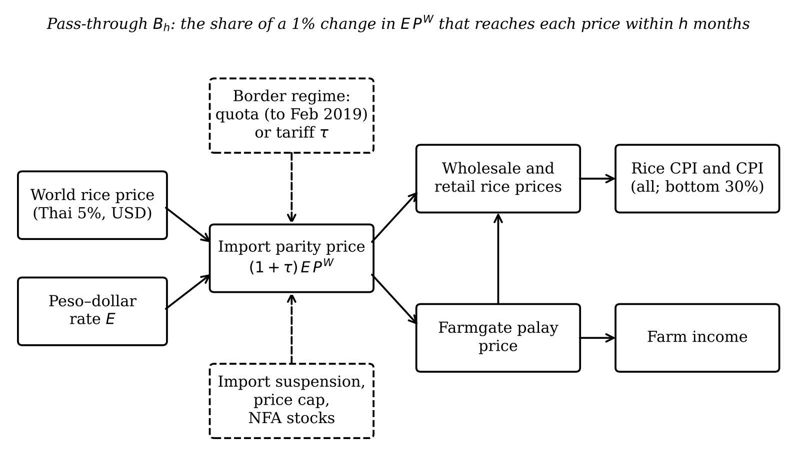

<#-- Rendered by scripts/08_paper.py. Every number comes from output/tables via n (paper_numbers.json) and t (tables). Do not edit the rendered .md or .docx. --#>

**Abstract.** In March 2019 the Philippines replaced its quantitative restrictions on
rice imports with a 35% tariff (Republic Act 11203, the Rice Tariffication Law). We ask
whether the law changed how much of a world rice price movement reaches Filipino
consumers and farmers. We first reproduce the data and the main impulse response of
Antonio et al. [-@antonio2025] exactly, then estimate local projections on a panel of
17 regions from 1995 to September 2026. Before the law, a 1% rise in the world rice
price in pesos raised regional rice consumer prices by {{ n.rq1_pre_6 }} percentage
points within six months; after the law, by {{ n.rq1_post_6 }}. The increase is
significant only at the 10% level and is fragile: it is smaller with data ending in
June 2024 and with macroeconomic controls at twelve months. Along the supply chain,
pass-through to farmgate palay, wholesale and retail prices was close to zero from
2011 to 2019 and between {{ n.rq2_retail_rmr_post_6 }} and {{ n.rq2_farmgate_palay_post_6 }}
afterwards, so farmers are now more exposed to world prices than consumers. World rice
shocks are regressive: the consumer price index (CPI) of the poorest 30% of households
responds {{ n.rq5_ratio6 }} times as strongly as the all-income CPI. The 2024 tariff cut
from 35% to 15% did not reach consumers: rice prices fell by about what world prices
alone predicted, and the gap between domestic and world prices widened. The
2025 import suspension was followed by a {{ n.ep_e4_rice_nov25_apr26 }}% rise in the rice
CPI between November 2025 and April 2026.

**Keywords:** rice; tariffication; price transmission; local projections; inflation
inequality; Philippines. **JEL:** F13, Q17, Q18, E31.

# Chapter 1. Introduction

## 1.1 Background

Rice is the Philippine staple. In the 2018 consumer basket rice takes
{{ n.w_rice_all }}% of spending for the average household and {{ n.w_rice_b30 }}% for the
poorest 30% (the PSA's official CPI weights). About two million farm households sell
palay, the unmilled grain. A change in the price of rice therefore moves the cost of
living of the poor, the income of farmers and headline inflation at the same time.

For decades the government kept imported rice out with *quantitative restrictions*
(QR): only the National Food Authority (NFA), or traders holding its permits, could
import, and only in the volumes the government allowed. Republic Act (RA) 11203, the
*Rice Tariffication Law* (RTL), approved on 14 February 2019 and in force from March
2019, replaced the quotas with a tariff: 35% on rice from countries of the Association
of Southeast Asian Nations (ASEAN), with any private importer free to bring in any
amount once the duty is paid. The tariff revenue funds the Rice Competitiveness
Enhancement Fund (RCEF) for farmers. The border kept changing afterwards. Executive
Order (EO) 62 cut the tariff to 15% from July 2024; EO 93 and EO 102 suspended imports
of regular- and well-milled rice from September to December 2025; and from January
2026 EO 105 ties the tariff (15–35%) to world prices. All policy facts are listed with
their sources in `paper/policy_context.md`.

## 1.2 Rationale

Each of these measures rests on a claim about *pass-through*, that is, about how much
of a change in the cost of imported rice reaches domestic prices. The law's promise
was that open imports would tie domestic prices to cheaper world prices. The 2024 tariff
cut assumed that a lower duty would lower retail prices. The 2025 suspension assumed
that keeping imports out would raise palay prices. Yet the evidence on pass-through
since 2019 is thin and mixed. Simulation studies predicted large falls in retail prices
[@balie2020; @briones2019]; time-series studies find weak long-run links between world
and domestic prices and strong market power downstream [@bathan2025; @trinidad2026].
The closest study to ours, Antonio et al. [-@antonio2025], shows that world rice prices
are the largest driver of regional rice inflation from 1994 to 2023, but it does not
ask whether the law changed that link.

## 1.3 Objectives

The **general objective** is to measure whether, and for whom, the RTL changed the
transmission of world rice prices to Philippine rice prices.

*Objective 1 (descriptive)* is to document how rice prices, their volatility, their gap
to world prices and their dispersion across regions behaved before and after the law,
and how much rice contributed to inflation for all households and for the poorest 30%.

*Objective 2 (estimation)* is to estimate pass-through and its change with the law. It
answers five research questions (RQs). **RQ1:** how much of a 1% change in the world
rice price, in pesos, reaches regional consumer rice prices within 6 and 12 months, and
did this change after March 2019? **RQ2:** did the law change pass-through to farmgate,
wholesale and retail prices differently? **RQ3:** did the gap between domestic and
world prices fall after the law, and again after the 2024 tariff cut? **RQ4:** did the
change differ between rice-deficit and rice-surplus regions, and between high- and
low-poverty regions? **RQ5:** do world rice shocks raise the CPI of the poorest 30%
more than the all-income CPI?

We test competing hypotheses. **H1a (integration):** pass-through rose, as the
trade-reform literature predicts when quotas become an ad valorem tariff
[@baffes2003; @mundlak1992]. **H1b (rigidity):** it did not rise, because of market
power and downward price rigidity in the domestic chain [@trinidad2026; @bathan2025].
**H2:** farmgate pass-through rose more than retail pass-through. **H3:** the gap fell,
but by less than the tariff change implies. **H4a:** the increase was larger in
rice-deficit regions; **H4b:** no difference. **H5:** world rice shocks are regressive.

*Objective 3 (policy)* is to use the estimates to assess the 2024 tariff cut, the 2025
import suspension and the 2026 price-indexed tariff, in pesos for a poverty-line family.

## 1.4 Significance

For the Department of Agriculture (DA), the National Economic and Development
Authority's successor, the Department of Economy, Planning and Development (DEPDev),
and the Tariff Commission, the study says how much a tariff change is likely to move
retail and farmgate prices, and how quickly. For the Bangko Sentral ng Pilipinas (BSP),
it measures how strongly world rice shocks feed into the CPI. For social protection,
it shows how much more these shocks hurt the poorest households.

## 1.5 Scope and limitations

The study uses monthly official data for 17 regions from 1994 to September 2026. It
measures *price* responses; it does not measure quantities, profits or welfare
directly. The law is a single national event, so the comparison is between periods,
not between treated and untreated places, and other things changed after 2019
(the pandemic, the 2023 world price spike, the 2024 tariff cut). We address this with
robustness checks, a placebo law date and an out-of-sample test, but the "after the
law" period mixes the law with everything that followed. Finally, the replication of
the reference paper passed on data and on the main response but failed on one
pre-registered criterion about region groups (Section 4.4); results by region group
are therefore labelled as not validated.

## 1.6 Definition of terms

**Log change and inflation.** We measure every change as 100 times the change in the
natural logarithm, which is close to the percentage change for small changes:
$\pi_t = 100\,[\ln P_t - \ln P_{t-1}]$. If the rice CPI goes from 100 to 101, $\pi_t
\approx 1.0$.

**World rice price shock.** $f_t = 100\,\Delta \ln(P^W_t E_t)$, where $P^W_t$ is the
World Bank's Thai 5% broken rice price in US dollars per tonne and $E_t$ is pesos per
dollar. If the dollar price rises 3% and the peso is unchanged, $f_t \approx 3$.

**Pass-through.** How many percentage points domestic prices rise for each 1% rise in
the world price. The cumulative pass-through after $h$ months is
$B_h = \sum_{j=0}^{h}\beta_j$. A value of $B_6 = 0.4$ means that a 10% world price
rise raises the domestic price by about 4% within six months.

**Change in pass-through.** $\theta_h = B^{\text{after}}_h - B^{\text{before}}_h$.

**Inflation gap.** $D_t = 100\,\ln(P^{A}_t/P^{B30}_t)$, where $A$ is the all-income CPI
and $B30$ the bottom-30% CPI; its monthly change is $\Delta D_t = \pi^{A}_t -
\pi^{B30}_t$. If $\Delta D$ is negative, prices rose faster for the poor: the shock is
*regressive*.

**Border gap.** $G_t = 100\,\ln(P^{\text{dom}}_t / (P^W_t E_t/1000))$, the domestic
price per kilogram relative to the world price per kilogram, both in pesos.

**Official statistics and our constructions.** The CPIs (all income and bottom 30%),
their weights, and the retail, wholesale and farmgate prices are the Philippine
Statistics Authority's (PSA). The shock, the gaps, the spliced series, the region
groups (taken from Antonio et al.) and all estimates are ours.

# Chapter 2. Review of Related Literature

## 2.1 How world prices reach domestic markets

The law of one price says that, with free trade, the domestic price of an imported good
equals the world price times the exchange rate, plus the tariff and transport costs.
Mundlak and Larson [-@mundlak1992] estimate that domestic agricultural prices move
almost one-for-one with world prices on average, while Baffes and Gardner
[-@baffes2003] show that transmission depends on policy: it is weak under quotas and
state trading and rises after reforms. A quota cuts the link, because the domestic price
is set by domestic supply and the quota, while the quota rent absorbs world price
changes. A tariff restores the link, scaled by the share of imported cost in the final
price. Dawe [-@dawe2008] and Dawe and Timmer [-@dawe2012] explain why Asian governments,
including the Philippines, long chose stable domestic rice prices over integration with
a thin and volatile world market.

## 2.2 Empirical pass-through and its timing

Studies of food price transmission to developing countries find partial and slow
transmission [@ceballos2017; @dawe2015]. Furceri et al. [-@furceri2016] use local
projections to show that global food price shocks raise domestic headline inflation
for several months, more in poorer countries. Kpodar and Liu [-@kpodar2022] use the same
method, with a correction for later shocks, to show that fuel price increases raise the
inflation of poor households more. Price responses along a chain are often asymmetric:
increases pass through faster than decreases [@meyer2004].

## 2.3 Rice tariffication in the Philippines

Before the law was passed, simulations predicted that removing quotas would lower
retail rice prices by 10–17% and farm prices by more [@balie2020; @briones2019], with
net gains for poor consumers and losses for many farmers [@balie2021; @briones2021].
Clarete [-@clarete2022] stresses that market structure decides whether the gains
reach consumers. After the law, Bathan et al. [-@bathan2025] find, with autoregressive
distributed lag models on 2012–2024 data, that farmgate prices drive wholesale and
retail prices asymmetrically and that the law had only short-run effects. Bathan
[-@bathan2026] finds similar vertical responses after tariffication. Trinidad, Ravago and
Balisacan [-@trinidad2026] find limited transmission from international to domestic
prices and argue that competition policy must accompany tariff cuts.

## 2.4 Regional evidence and the reference study

Valera, Balié and Magrini [-@valera2022] show that rice prices are a major source of
regional inflation. Antonio et al. [-@antonio2025] estimate a panel vector
autoregression (VAR) for 17 regions from 1994 to 2023: a world rice shock raises
regional rice inflation, peaks after one month and fades within about five months;
the effect is larger in rice-deficit regions. Their data are public, so we use their
paper as the reference to replicate.

## 2.5 Synthesis and gap

The literature agrees that world prices matter and that the domestic chain is not
perfectly competitive. It does not tell us whether the switch from quotas to tariffs
*changed* pass-through to consumers, farmers and the poor, and how the later policy
reversals (tariff cut, suspension, indexed tariff) fit that picture. That is the gap
this study fills.

## 2.6 Conceptual framework

Figure 1 summarises the framework. The world price and the exchange rate set the
import parity price, $(1+\tau)E_tP^W_t$. The border regime decides how much of a change
in that price reaches the wholesale, retail and farmgate markets: under a quota very
little, under a tariff more. Retail rice prices feed the CPI, with a weight twice as
large for the poor. Dashed arrows show the policy levers studied in Objective 3.

{width=95%}

The general theory gives the estimating equation. If importers price at import parity
plus a marketing margin $m$, $P^{\text{dom}} = (1+\tau)EP^W + m$, then a 1% change in
$EP^W$ changes the domestic price by
$\partial\ln P^{\text{dom}}/\partial\ln(EP^W) = (1+\tau)EP^W/P^{\text{dom}}$, the share
of the import cost in the final price. Under a binding quota this elasticity is close
to zero. The farmgate price is the milled price minus milling and marketing costs, so
in percentage terms it moves *more* than the retail price [@gardner1975], which is H2.
Finally, by cost-of-living index theory, group $g$'s inflation is
$\pi^g = \sum_k w^g_k\pi_k$, so the effect of a rice shock on the gap is roughly
$B^{\text{rice}}_h(w^{A}_{\text{rice}} - w^{B30}_{\text{rice}})$, which is negative because
the poor's rice weight is larger (H5). Deaton [-@deaton1989] and Ivanic and Martin
[-@ivanic2008] show that the welfare effect then depends on whether a household is a
net buyer or a net seller of rice.

# Chapter 3. Digression: the model and how to implement it

This chapter is a tutorial. Someone new to the method should be able to reproduce the
study from it.

## 3.1 The question an impulse response answers

We want the path of domestic rice prices in the months after a world price change,
holding everything else as it would otherwise have been. That path is an *impulse
response*: the response of $y$ at $t+h$ to a one-unit shock at $t$, for $h = 0, 1, 2,\dots$

## 3.2 The local projection idea

A VAR estimates one model of how all variables evolve together and then iterates it
forward to get the responses. A *local projection* [@jorda2005] skips the iteration: for
each horizon $h$ it runs a separate regression of the outcome $h$ months ahead on
today's shock. If the VAR is right both give the same answer [@plagborg2021]; if it is
wrong, the local projection is more robust, and its standard errors are simple
[@montielolea2021].

## 3.3 The specification term by term

For each $h = 0, \dots, 12$ we estimate by ordinary least squares

$$\sum_{j=0}^{h}\pi_{r,t+j} = \alpha_{r} + B_h f_t + \theta_h (f_t\times \text{post}_t) + \sum_{q=1}^{12}\gamma_q \pi_{r,t-q} + \sum_{q=1}^{12}\lambda_q f_{t-q} + \sum_{l=1}^{h-1}\rho_l f_{t+l} + \delta\, \text{post}_t + \kappa t + \varepsilon_{r,t+h}. \quad (1)$$

The left side is the *cumulative* rice inflation from $t$ to $t+h$ in region $r$, so
$B_h$ is directly the cumulative pass-through. $\alpha_r$ are *region fixed effects*:
they let each region have its own average inflation. The twelve past values of rice
inflation and of the shock account for earlier movements and for seasonal patterns,
such as the lean months before the harvest. The *Teulings–Zubanov leads*
$f_{t+1},\dots,f_{t+h-1}$ make sure $B_h$ is not confused with the effect of later
shocks [@teulings2014]. $\text{post}_t$ equals 1 from March 2019; $\theta_h$ is the change
in pass-through after the law, and $B_h + \theta_h$ is the post-law pass-through. The
trend $\kappa t$ absorbs slow drifts.

## 3.4 From monthly effects to the level

Because the left side is a running sum, $B_6 = 0.4$ means that a 1% world price rise
raises the *level* of the rice CPI by 0.4% after six months. The monthly effect at
horizon $h$ is $B_h - B_{h-1}$.

## 3.5 Standard errors

Standard errors measure how uncertain an estimate is. Because all regions face the same
world price in the same month, their errors are correlated across regions and over time.
*Driscoll–Kraay* standard errors [@driscoll1998] allow for correlation over time and
across regions; for single national series we use *Newey–West* standard errors
[@newey1987], which allow for correlation over time. Bands in the figures are 90%
intervals.

## 3.6 The panel and group differences

To ask whether a group $G$ of regions (for example rice-deficit regions) changed
differently, we add $f_t\times G_r$, $f_t\times\text{post}_t\times G_r$ and the
corresponding dummies. The coefficient on the triple product is the extra change in
group $G$.

## 3.7 Checking the implementation

Before any real estimate we checked the code in two ways. First, simulation tests
(`tests/test_lp.py`, `tests/test_pvar.py`) generate data with a known response and
confirm that the estimators recover it. Second, the replication gate (Section 4.4)
reproduces a published result on the same public data.

## 3.8 Step-by-step implementation

The whole study runs from one command, `./run_all.sh`. The steps are: download the raw
files unchanged (`scripts/01_download_*.py`); clean them into long tables
(`02_clean_*.py`); build the regional and national panels (`03_build_panel.py`); run
the replication gate (`04_replicate.py`); estimate (`05_estimate.py`); run the episode
analysis (`07_episode_2024.py`) and the descriptive statistics (`09_descriptive.py`);
draw the figures (`06_figures.py`); and render the documents (`08_paper.py`,
`10_analysis_report.py`, `11_master_document.py`). The core call is:

```python
from rtl.lp import local_projection
res = local_projection(panel, y="dl_rice", x="f", time="t", unit="region",
                       horizons=12, p=12, interact=("post",), exog=("post",),
                       cumulative=True, se="driscoll_kraay")
```

## 3.9 Common pitfalls

Do not mix outcomes in levels and shocks in changes. Do not drop the leads: without them
$B_h$ partly measures later shocks. Do not use standard errors clustered only by region
when the shock is common to all regions: robustness check (o) shows they are several
times too small. Do not read a single significant horizon as a result; decide in
advance which horizons count (here $h = 6$ and $h = 12$).

# Chapter 4. Methodology

## 4.1 Design

The design compares pass-through before and after a national policy change, within a
panel of regions, with the reference study replicated first and every specification
fixed in advance. The pre-registered plan, the decisions log (D1–D12) and the
replication gate are in `CLAUDE.md` and were committed to the repository before the
corresponding estimates were run.

## 4.2 Data

Table 1 lists the variables. All are official and public; each raw file is logged in
`data/raw/source_log.md` with its URL, date pulled, base year and coverage.

| Variable | Symbol | Source | Coverage | Use |
| :--- | :--- | :--- | :--- | :--- |
| Rice CPI, all income, by region (item 01.1.1.12, 2018 = 100) | $P^{R}_{rt}$ | PSA OpenSTAT | 1994M1–2026M9 | RQ1, RQ4, Objective 3 |
| All-items CPI, all income and bottom 30% | $P^{A}_t, P^{B30}_t$ | PSA OpenSTAT | 2000M1–2026M9 | RQ5 |
| CPI weights 2018 (all income; bottom 30%) | $w^g_k$ | PSA OpenSTAT | 2018 | RQ5, Objective 3 |
| Retail, wholesale prices of regular-milled rice; farmgate palay | $P^{\text{ret}}, P^{\text{whs}}, P^{\text{farm}}$ | PSA price surveys | 2010M1–2026M9 | RQ2, RQ3 |
| Thai 5% and Viet 5% rice; urea; Dubai crude | $P^W_t$ | World Bank Pink Sheet | 1990M1–2026M9 | Shock, robustness |
| Peso–dollar rate, monthly average | $E_t$ | BSP | 1990M1–2026M9 | Shock |
| Oceanic Niño Index | ONI | NOAA | 1990M1–2026M8 | Replication, robustness |

: Table 1. Variables and sources.

Three construction choices matter. *Geography:* we use PSA's old 17-region code, which
has the long history, and extend it to 2026 with the growth of the new code; four regions
whose boundaries changed (Western and Central Visayas, SOCCSKSARGEN, BARMM) are flagged
for those months (D5). *Splicing:* national retail prices join three PSA survey series
on growth rates; the 2012-based and 2018-based series agree closely (correlation of
monthly changes 0.99), the 1990-based series less so (D12). *Validation:* the rice CPI
and the separate retail price survey move together (correlation of monthly changes
{{ n.val_cpi_retail }}); the bottom-30% and all-income rice CPIs correlate at
{{ n.val_all_b30 }}; the Thai and Vietnamese world prices correlate at only
{{ n.val_thai_viet }}, which is why the Vietnamese price is a robustness check.

## 4.3 Methods by objective

*Objective 1* uses summary statistics by sub-period, annual inflation by income group,
the contribution of rice to headline inflation (rice weight times rice inflation),
episodes of world price spikes (at least three months with a 12-month rise of 15% or
more), cross-correlations between the shock and rice inflation, the dispersion of rice
prices across regions, and unit-root tests.

*Objective 2* uses equation (1) for RQ1 (panel, 1995–2026), the same equation on national
farmgate, wholesale and retail prices for RQ2 (2011–2026, Newey–West), an interrupted
time-series regression of the border gap $G_t$ on dummies for the law, the 15% tariff and
the suspension with month dummies for RQ3, triple interactions for RQ4, and national
local projections of the all-items CPIs and of $\Delta D_t$ for RQ5 (2001–2026). The
decisive horizons are $h = 6$ and $h = 12$; for RQ4 we use a Bonferroni correction
across the two group tests, so each is judged at 5%. The robustness menu has fifteen
checks, lettered (a) to (o), listed in Table 6.

*Objective 3* applies the post-law pass-through, estimated only on data that end in
June 2024, to the July 2024 tariff cut, which lowers the peso cost of imports by
$100\ln(1.15/1.35)$ = {{ n.ep_tau }} log points. The predicted change in the rice CPI from
June 2024 to month $m$ is $\sum_t B_{m-t}(f_t + \tau_t)$; we compare it with the actual
change, by region, and convert the tariff part into pesos for a poverty-line family of
five, using the PSA's 2023 poverty threshold (PHP {{ n.ep_threshold }} a month) and the
bottom-30% rice weight. The 2025 suspension is analysed descriptively (exploratory).

## 4.4 Validation: the replication gate

We fixed the pass criteria before downloading any data (Table 2). The data replication
is exact: our regional rice CPI means and standard deviations for 1994M1–2023M3 equal
those in Antonio et al.'s Table 1 in all 17 regions (largest deviation
{{ n.g1_max_dev }}), and their "fuel price" turns out to be CPI item 07.2.2, transport
fuels (the other candidate deviates by {{ n.g1b_other_dev }} points). Our panel VAR
replica reproduces their main response: a one-standard-deviation world price shock
raises rice inflation by {{ n.g2_h1 }} points after one month (95% band {{ n.g2_h1_lo }} to
{{ n.g2_h1_hi }}), the peak, and the response is gone by month six
({{ n.g2_h6 }}). The gate **failed** on the third criterion: the peak response in
rice-deficit regions is {{ n.g3_peak_ratio }} times that in surplus regions, below the
pre-registered range of 1.3 to 3.0, and the peak in high-poverty regions is not below
that in low-poverty regions. No coding error was found, and two lags give the same
ratio ({{ n.g3_peak_ratio_p2 }}). An exploratory look shows that the paper's wording fits
the *impact* response better than the peak (impact ratio {{ n.g3_impact_ratio }}; low-
versus high-poverty impact {{ n.g3_impact_low_poverty }} versus {{ n.g3_impact_high_poverty }}),
but we did not change the criterion. We proceeded with estimation (decision D11) because
the data and the core estimator are validated; region-group results (RQ4) are labelled
as not validated.

{{ t.gate }}

: Table 2. Replication gate against Antonio et al. (2024), pre-registered 14 October 2026.

{width=90%}

## 4.5 Software and reproducibility

Python 3 with pandas, statsmodels and linearmodels; figures in matplotlib; documents
rendered from templates with Jinja2 and pandoc. Raw files are kept unchanged; every
output and every number in this paper is regenerated by `./run_all.sh`.

## 4.6 Ethics

The study uses only published aggregate statistics; no human subjects are involved.

# Chapter 5. Results and Discussion

## 5.1 Objective 1: rice prices before and after the law

Figure 2 shows the rice CPI and the world rice price in pesos since 1995. Until 2008 the
two move together loosely; the 2008 world price spike passes into domestic prices with
a lag and a smaller amplitude. Between 2012 and 2018, under quotas, the domestic price
stays well above the world price and barely reacts to it. After 2019 the two move
together much more closely, including the 2023 spike and the 2025 fall, until the
domestic surge of early 2026 at a time of stable world prices.

{width=95%}

Table 3 summarises rice inflation by period. Under quotas (2009 to February 2019)
monthly rice inflation was calm, with a standard deviation of {{ n.desc_sd_rice_quota }}
points. It rose to {{ n.desc_sd_rice_tariff35 }} under the 35% tariff and to
{{ n.desc_sd_rice_late }} after July 2024: an open border imports world volatility. In the
law's first year (2019) the rice CPI fell by {{ n.ann_rice_all_2019 }}% (December to
December), and by {{ n.ann_rice_b30_2019 }}% for the bottom 30%. In 2023, when world
prices spiked, it rose by {{ n.ann_rice_all_2023 }}%, contributing about
{{ n.ann_rice_contrib_all_2023 }} percentage points to headline inflation for all
households and {{ n.ann_rice_contrib_b30_2023 }} for the bottom 30% (Table 4).

{{ t.desc_periods }}

: Table 3. Rice CPI inflation and world rice price changes by period (national; annualised means of monthly log changes, and standard deviations of monthly changes).

{{ t.desc_annual }}

: Table 4. Annual inflation (December to December, log points) and the approximate contribution of rice to headline inflation (2018 rice weight × rice inflation). 2026 is September 2025 to September 2026.

Regional rice prices also converged. The coefficient of variation of retail
regular-milled rice prices across regions fell from {{ n.cv_2015_17 }}% in 2015–2017 to
{{ n.cv_2021_24 }}% in 2021–2024, a sign of better-integrated regional markets, before
rising to {{ n.cv_2026 }}% in 2026 (Figure 3). The border gap (Figure 4) fell from an
average of {{ n.rq3_mean_gap_pre }} log points under quotas (2010 to February 2019) to
{{ n.rq3_mean_gap_tariff35 }} under the 35% tariff, and rose again to
{{ n.rq3_mean_gap_after2024 }} after the tariff cut. We identify
{{ n.desc_n_episodes }} world price episodes since 1995 (Annex Table A1). Before the
law, world price shocks were followed by rice inflation with a correlation of at most
{{ n.cc_pre_max }}; after the law, by up to {{ n.cc_post_max }} at a lag of
{{ n.cc_post_kmax }} months. Rice CPI levels are not stationary (augmented Dickey–Fuller
p = {{ n.adf_rice_level_p }}); monthly changes are, which is why we model changes.

{width=80%}

{width=95%}

## 5.2 Objective 2: pass-through and the law

**RQ1: consumer rice prices.** Over the whole period, a 1% rise in the world price
raises regional rice CPIs by {{ n.rq1_full_6 }} percentage points within six months and
{{ n.rq1_full_12 }} within twelve. Table 5 and Figure 5 split this by regime. Before
the law, pass-through at six months was {{ n.rq1_pre_6 }} ({{ n.rq1_pre_6_se }}); after
it, {{ n.rq1_post_6 }} ({{ n.rq1_post_6_se }}), about {{ n.rq1_ratio6 }} times larger.
The change θ~6~ = {{ n.rq1_th_6 }} ({{ n.rq1_th_6_se }}) is significant at the 10%
level only (p = {{ n.rq1_th_6_p }}); at twelve months it is {{ n.rq1_th_12 }}
({{ n.rq1_th_12_se }}, p = {{ n.rq1_th_12_p }}), not significant. The national rice CPI
gives the same picture ({{ n.rq1_nat_pre_6 }} before, {{ n.rq1_nat_post_6 }} after).
So the evidence supports H1a at six months, weakly, and cannot reject H1b at twelve.

{{ t.rq1 }}

: Table 5. Cumulative pass-through of a 1% world rice price change (pesos) to regional rice CPIs, percentage points; Driscoll–Kraay standard errors in parentheses; \*, \*\*, \*\*\* significant at 10%, 5%, 1%. 17 regions, 1995M1–2026M9.

{width=80%}

The robustness checks (Table 6, Figure 6) show where the result is solid and where it
is fragile. The change at six months ranges from {{ n.rob_min6 }} to {{ n.rob_max6 }} across
the checks and keeps its 90% band above zero in {{ n.rob_n_sig6 }} of {{ n.rob_n_checks6 }}
checks with standard errors; at twelve months it ranges from {{ n.rob_min12 }} to
{{ n.rob_max12 }} and its band excludes zero in {{ n.rob_n_sig12 }}. It
is larger without the 2007–08 crisis ({{ n.rob_f_no_2008crisis_6 }}), without 2020
({{ n.rob_g_no_2020_6 }}), and in a window of seven years on each side of the law
({{ n.rob_i_symmetric_2012_6 }}, significant at 5%, and {{ n.rob_i_symmetric_2012_12 }} at
twelve months). It weakens with the Vietnamese price ({{ n.rob_b_viet5_6 }}, imprecise)
and, importantly, with data ending in June 2024: then the change at six months is only
{{ n.rob_h_end_2024m6_6 }} ({{ n.rob_h_end_2024m6_6_se }}). With macroeconomic controls
the change at twelve months falls to {{ n.rob_d_macro_controls_12 }}. Leaving out any one
region changes $\theta_6$ only within {{ n.rob_loo_lo_6 }} to {{ n.rob_loo_hi_6 }}. A placebo
law date in March 2016, within the quota period, gives {{ n.rob_placebo_6 }}
({{ n.rob_placebo_6_se }}), not significant. Standard errors clustered only by region are
several times smaller and overstate precision, as Section 3.9 warned.

{{ t.robust }}

: Table 6. Robustness of the change in pass-through after the law, θ, at 6 and 12 months (percentage points per 1%); standard errors in parentheses; for (l) the range across the 17 leave-one-out estimates.

{width=95%}

**RQ2: along the chain.** The clearest result of the study is in Table 7 and Figure 7.
From 2011 to February 2019, pass-through to farmgate, wholesale and retail prices was
statistically zero at every stage. After the law, six-month pass-through is
{{ n.rq2_farmgate_palay_post_6 }} for farmgate palay, {{ n.rq2_wholesale_rmr_post_6 }} for
wholesale rice and {{ n.rq2_retail_rmr_post_6 }} for retail rice; all changes are
significant at six months. At twelve months the changes are smaller and less precise.
Farmgate pass-through is the largest, which supports H2: as the framework predicts,
the price farmers receive now moves more, in percent, than the price consumers pay. The
regional farmgate panel gives a similar post-law value ({{ n.rq2_farmreg_post_6 }}).
In this window the pre-law consumer pass-through is near zero rather than the
{{ n.rq1_pre_6 }} of the long sample, because the 1995–2008 years, when world and
domestic prices moved together, are excluded.

{{ t.rq2 }}

: Table 7. Cumulative pass-through to national farmgate, wholesale and retail rice prices and the rice CPI, before and after the law, 2011M1–2026M9; Newey–West standard errors in parentheses.

{width=100%}

**RQ3: the border gap.** Table 8 shows that the wholesale–world gap fell by
{{ n.rq3_wholesale_its_post }} log points after the law (p =
{{ n.rq3_wholesale_its_post_p }}), and rose by {{ n.rq3_wholesale_its_tariff15 }} after the
2024 tariff cut (p = {{ n.rq3_wholesale_its_tariff15_p }}). Holding the world price
constant (columns 2 and 4), the gap moves {{ n.rq3_wholesale_its_world_ln_world }} points
for each 1% rise in the world price, so domestic prices absorb only a small part of
world movements in *levels*; the law dummy is then no longer negative, and the tariff
cut is associated with a gap {{ n.rq3_wholesale_its_world_tariff15 }} points wider. H3 is
rejected for the 2024 cut: lowering the duty by 20 points did not narrow the gap.

{{ t.rq3 }}

: Table 8. Interrupted time-series regressions of the border gap (100 × ln domestic/world price), 2010M1–2026M9, with month dummies; Newey–West (12 lags) standard errors in parentheses. Columns (2) and (4) add the log world price.

**RQ4: regions (not validated).** Table 9 and Figure 8 show no significant difference at
the decisive twelve-month horizon: the extra change in rice-deficit regions is
{{ n.rq4_insuff_12 }} ({{ n.rq4_insuff_12_se }}) and in high-poverty regions
{{ n.rq4_highpov_12 }} ({{ n.rq4_highpov_12_se }}). At six months the high-poverty term is
{{ n.rq4_highpov_6 }} (p = {{ n.rq4_highpov_6_p }}), below the Bonferroni threshold, but
this horizon was not the decisive one. We cannot reject H4b. Because the reference
paper's group ordering did not replicate (Section 4.4), we put little weight on these
group results.

{{ t.rq4 }}

: Table 9. Extra change in pass-through after the law in rice-deficit and high-poverty regions (θ on shock × post × group), percentage points per 1%; Driscoll–Kraay standard errors; Bonferroni threshold 5% for each test.

{width=80%}

**RQ5: the poor.** A 1% world rice price rise raises the all-items CPI of all households
by {{ n.rq5_all_6 }} percentage points within six months and that of the bottom 30% by
{{ n.rq5_b30_6 }}, {{ n.rq5_ratio6 }} times as much (Table 10, Figure 9). The inflation
gap falls by {{ n.rq5_gap_6 }} ({{ n.rq5_gap_6_se }}): world rice shocks are regressive,
supporting H5. The difference in rice weights alone ({{ n.w_rice_b30 }}% against
{{ n.w_rice_all }}%) predicts a gap of {{ n.rq5_mech6 }}, about {{ n.rq5_mech_share }}% of
the estimate; the rest presumably comes from other foods whose prices follow rice, which
also weigh more for the poor. The law did not change the regressive pattern
(θ~6~ = {{ n.rq5_gapth_6 }}, standard error {{ n.rq5_gapth_6_se }}).

{{ t.rq5 }}

: Table 10. Cumulative response of national all-items CPIs, their gap and the national rice CPI to a 1% world rice price rise, percentage points, 2001M1–2026M9; Newey–West standard errors.

{width=95%}

## 5.3 Objective 3: what the estimates imply for policy

**The 2024 tariff cut.** Using only data up to June 2024, the post-law model predicts
that the rice CPI should have fallen by {{ n.ep_e1_pred_total_m12 }} log points between
June 2024 and June 2025: {{ n.ep_e1_pred_world_m12 }} from falling world prices and
{{ n.ep_e1_pred_tariff_m12 }} from the tariff cut. The actual fall was
{{ n.ep_e1_actual_m12 }}, {{ n.ep_e1_share_world_m12 }}% of the world-price part alone
and {{ n.ep_e1_share_total_m12 }}% of the total (Figure 10). After six months the actual
fall ({{ n.ep_e1_actual_m6 }}) was only {{ n.ep_e1_share_total_m6 }}% of the predicted
({{ n.ep_e1_pred_total_m6 }}). In other words, consumers received the fall in world
prices but not the tariff cut, the pattern Trinidad, Ravago and Balisacan
[-@trinidad2026] describe. In {{ n.ep_n_regions_below_pred }} of 17 regions the fall
exceeded the prediction (Annex Table A2); the largest fall was in
{{ n.ep_e2_largest_fall_region }} ({{ n.ep_e2_largest_fall }}) and the smallest in
{{ n.ep_e2_smallest_fall_region }} ({{ n.ep_e2_smallest_fall }}) (Figure 11).

{width=80%}

{width=80%}

In pesos: a poverty-line family of five (PHP {{ n.ep_threshold }} a month in 2023) spends
about PHP {{ n.ep_e3_rice_spend }} a month on rice if its budget shares are those of the
bottom-30% CPI. A full pass-through of the tariff wedge would save it about PHP
{{ n.ep_e3_full_tariff_wedge }} a month; the model predicts PHP
{{ n.ep_e3_saving_tariff_m12 }} after a year; the actual fall in the bottom-30% rice CPI,
mostly due to world prices, was worth about PHP {{ n.ep_e3_saving_actual_m12 }}.

**The 2025 import suspension (exploratory).** Farmgate palay prices fell
{{ n.ep_e4_farm_aug25_sep25 }}% in September 2025, the first month of the suspension and
the start of the main harvest, then rose. Between November 2025 and April 2026 the rice
CPI rose {{ n.ep_e4_rice_nov25_apr26 }}% while the world price in pesos rose
{{ n.ep_e4_world_nov25_apr26 }}%. From August 2025 to April 2026, world prices alone predict
a rise of {{ n.ep_e4_retail_rmr_pred_apr26 }}% in retail and {{ n.ep_e4_farmgate_palay_pred_apr26 }}%
in farmgate prices; the actual rises were {{ n.ep_e4_retail_rmr_apr26 }}% and
{{ n.ep_e4_farmgate_palay_apr26 }}% (Figure 12). The suspension appears to have raised
farm prices, as intended, but with a delay and at a large cost to consumers that
outlasted the suspension itself. This reading is descriptive: imports resumed in January
2026 at a tariff that may have been 15% or 20% (`policy_context.md`, P12), and the model
was not designed for a closed border.

{width=95%}

**The 2026 price-indexed tariff.** EO 105 raises the tariff by 5 points for every 5%
fall in world prices and lowers it for every 5% rise, within bounds of 15% and 35%.
Near a 20% tariff, a 5% world price rise lowers the duty factor by
$\ln(1.15/1.20) \approx -4.3\%$, so the rule offsets about 85% of a world price move in
the peso cost of imports while the tariff stays within its bounds. Combined with a
post-law pass-through of about {{ n.rq1_post_12 }} at twelve months, the rule would leave
only a small part of world price moves in consumer prices, but only between the bounds,
and only if tariff changes pass through, which the 2024 episode questions. Our data
cover only nine months of the rule, so we do not estimate it.

# Chapter 6. Summary, Conclusions and Recommendations

## 6.1 Summary

*Objective 1.* Since the law, domestic rice prices track world prices more closely,
regional prices have converged, and monthly rice inflation has become more volatile.
The domestic–world gap narrowed under the 35% tariff and widened again after 2024.

*Objective 2.* Pass-through to consumer rice prices roughly doubled to tripled after the
law at six months ({{ n.rq1_pre_6 }} to {{ n.rq1_post_6 }}), but the change is significant
only at 10% and is fragile. Along the chain, pass-through went from about zero to
about {{ n.rq2_retail_rmr_post_6 }}–{{ n.rq2_farmgate_palay_post_6 }}, largest for farmers.
World rice shocks raise the poor's CPI {{ n.rq5_ratio6 }} times as much as the average.

*Objective 3.* The 2024 tariff cut did not reach consumers within a year; the 2025
suspension was followed by a sharp rise in both farmgate and retail prices.

## 6.2 Conclusions

The law did open the border to world price movements, most clearly for farmers, and it
coincided with a large one-off fall in rice prices in 2019. But openness works in both
directions: the poor now feel world price spikes more, and later cuts in the tariff were
absorbed in the chain rather than passed on.

## 6.3 Recommendations

To the **Tariff Commission and DEPDev**: judge tariff changes by their pass-through. Our
estimates suggest that at most part of a tariff cut reaches retail prices within a year;
the indexed tariff of EO 105 should be evaluated after a full year of data. To the
**Philippine Competition Commission and the DA**: the widening gap after the 2024 cut
points to margins in importing, milling and wholesaling; monitor them. To the **DA and
the Department of Social Welfare and Development**: because world rice shocks raise the
poor's CPI {{ n.rq5_ratio6 }} times as much as the average (RQ5), support during world
price spikes is best targeted at poor households; border measures change prices for all
buyers. To the **DA**: in the 2025–26 episode farm prices rose mostly after the suspension
ended ({{ n.ep_e4_farmgate_palay_dec25 }}% above August 2025 by December, {{ n.ep_e4_farmgate_palay_apr26 }}%
by April 2026), while retail prices rose by {{ n.ep_e4_retail_rmr_apr26 }}% (E4, exploratory);
suspensions should be weighed against that consumer cost, and alternatives such as the
RCEF productivity programmes, which this study does not evaluate, deserve evaluation.

## 6.4 Further research

Household-level data from the Family Income and Expenditure Survey would show net
buyers and net sellers directly; import volumes and margins by stage would show where
the tariff cut was absorbed; and a longer post-2026 sample will allow the indexed tariff
to be evaluated.

# References

::: {#refs}
:::
